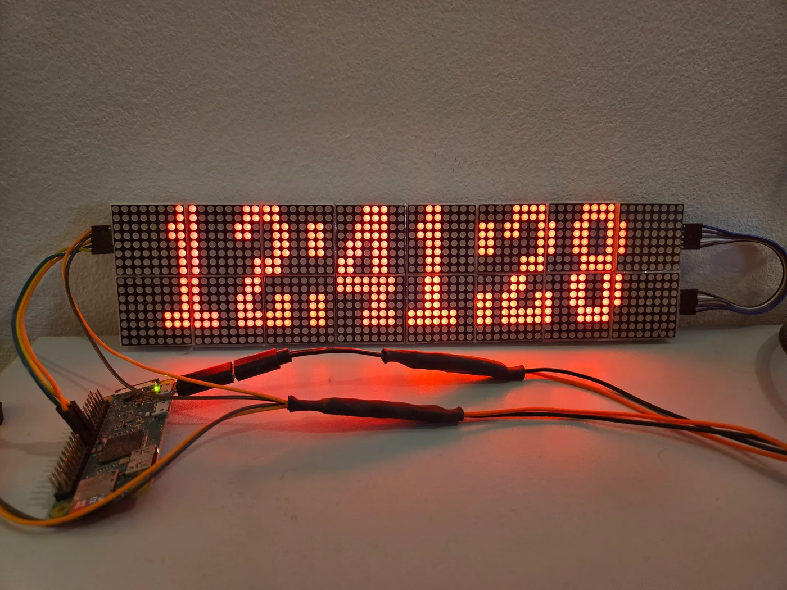

# LedBoard

A 64×16 LED display I built for my desk using a Raspberry Pi Zero WH and MAX7219 matrices. It shows the time, live bus departures, weather, and pixel animations. A Flask web controller lets me switch modes, send messages, and draw on the display from a phone or laptop.

[Watch the demo video](https://photos.google.com/share/AF1QipNOc32biwCpALE7iZqi61sBdthm-AGxb90jAhmkWQjUXPC99zsiK7GEY5G4OjBObw/photo/AF1QipMrXEdKHhnZgmrI52Dlr05eTZkYTQFsSsEsmqUG?key=b09VeXFpTjVEZ0NWTUp1U2I2Nm5oc0VxUXlxMHpB)



## Display modes

| Mode | What it shows |
| --- | --- |
| Clock | Hours, minutes, and seconds in large, fixed-width digits |
| Bus timetable | Scrolling MVG departures, with pauses to read each pair |
| Weather | Forecasts from Open-Meteo, including current conditions, temperatures, and rain |
| Messages | Up to two lines of text, with scrolling for longer messages |
| Pixel drawing | A 64×16 canvas with drawing, erasing, undo, and touch controls |
| Visualizers | Game of Life, Pong, Falling Sand, Drawing Harmonograph, Acid Rain, and simulated spectrum bars |

The controller also has an OFF button. Modes are selected manually. Message and drawing drafts stay in the current browser tab. The Music Visualizer generates simulated spectrum bars; it does not capture audio.

Bus departures are configured for **Garching, Untere Straßäcker**, serving lines **230**, **292**, and **X205** toward **Forschungszentrum**. The stop and route filters are in [my_bus_script3.py](app/my_bus_script3.py); weather settings are in [weather.py](app/weather.py).

## Hardware

- Original Raspberry Pi Zero WH with a pre-soldered GPIO header, running Raspberry Pi OS on ARMv6.
- Four MAX7219 4-in-1 boards: sixteen 8×8 LED matrices arranged as a 64×16 display.
- A microSD card, a 5 V / 3 A supply, and jumper wires for SPI.

The matrices form a 128×8 chain folded into two rows. Shared rendering helpers map the logical 64×16 image onto that chain, rotating the lower row to match the wiring.

## Rendering and mode changes

One persistent display thread owns the SPI connection. Each mode runs in a separate process and sends monochrome frames through pipes. During a mode change, a sweeping bar erases the outgoing image, keeps moving while the next mode prepares, and then reveals its first frame. Selecting OFF erases the display to black.

All modes share a day/night brightness schedule based on the Pi's local time. The browser shows switching progress and disables submissions until the transition finishes. The implementation is split across [display_owner.py](app/display_owner.py), [display_transition.py](app/display_transition.py), and [frame_transport.py](app/frame_transport.py).

## Run on a Raspberry Pi

This project assumes an SPI-enabled Pi with the required Python and native GPIO/SPI dependencies already configured. [requirements.txt](requirements.txt) records the direct dependency versions from the working board; the environment and hardware requirements are covered in the [application notes](docs/application.md#observed-runtime).

On a prepared Pi:

```bash
git clone https://github.com/BenTheurich/LedBoard.git
cd LedBoard/app
python3 app.py
```

Run from `app/` because the controller launches its workers using relative paths. Open `http://<pi-address>:5000` to use the controller. Startup scrolls the Pi's IP address and leaves the selected mode set to OFF.

Port 5000 has no authentication and is intended for a trusted local network. Optional password-protected browser access through Tailscale Funnel is described in [sharing access](docs/application.md#sharing-access).

The existing board starts through a cron `@reboot` entry. Pushing to GitHub does not deploy the application. See [startup](docs/application.md#existing-automatic-startup) and [deployment and recovery](docs/application.md#deployment-and-recovery) for the device's current layout and update procedure.

## Tests

The tests exercise rendering, frame transport, switching, the controller, and display modes without a physical matrix. From the repository root, with a Python virtual environment activated:

```bash
python -m pip install Flask==3.1.1 Pillow==11.1.0 tzdata
python -m pip install --no-deps luma.core==2.4.2
python -B -m unittest discover -s tests -v
```

This installs the dependencies for desktop tests. The Pi additionally needs its hardware drivers. See the [test notes](docs/application.md#hardware-free-tests) for more detail.

## Further documentation

- [Application notes](docs/application.md): rendering, mode behavior, dependencies, startup, deployment, and recovery.
- [Pi setup record](docs/pi-setup.md): the existing device and network configuration.
- [Network reference files](setup/network/README.md): configuration examples with credentials omitted.
- [Original source snapshot](docs/pi-app-snapshot.json): hashes of the files first imported from the Pi.

The Pi setup record describes my existing installation. Its hostname and private configuration paths still use `garching-board`.
